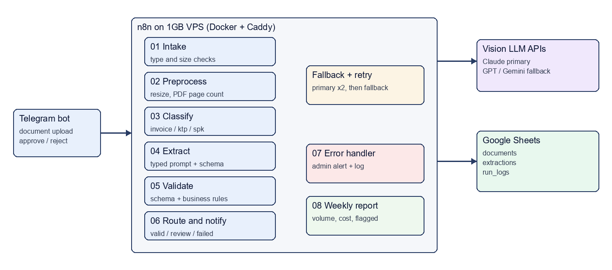

# Document Intelligence Pipeline with n8n

Vision-LLM extraction pipeline for dealership paperwork (invoices, KTP ID cards, sales orders), orchestrated by self-hosted n8n on a 1GB VPS. All documents are synthetic.



## What it does

1. A user sends a PDF, JPG or PNG to a Telegram bot.
2. n8n checks the file, resizes images and classifies the document type.
3. A vision LLM extracts fields with a typed prompt and a JSON schema (forced tool output).
4. Schema checks and business rules validate the result: invoice totals, NIK against birth date and gender, SPK price range, future dates.
5. Valid documents are stored in Google Sheets, questionable ones go to a human with inline approve/reject buttons, broken ones are reported with a reason.
6. Cost, tokens and latency are logged per step.

## Repository

| Path | Content |
|---|---|
| `infra/` | `docker-compose.yml`, `Caddyfile`, `.env.example`, `setup-vps.sh`, Sheets header CSVs |
| `workflows/` | Importable n8n workflows `01`-`08`, generated by `build.py` from `workflows/code/` |
| `schemas/` | JSON schemas per document type and the vehicle catalog used by SPK rules |
| `prompts/` | Classification and extraction prompts (`v2/` adds worked examples) |
| `data/` | Synthetic documents and ground truth |
| `eval/` | Dataset generator and benchmark runner, `results.md` |
| `docs/` | Architecture diagram and evaluation method |

## Setup

### 1. VPS

```bash
git clone <this repo> && cd document-intelligence-n8n/infra
sudo bash setup-vps.sh
cp .env.example .env   # fill in values
docker compose up -d
```

`setup-vps.sh` creates the 2GB swap file, installs Docker and opens ports 22, 80 and 443 only. n8n runs with filesystem binary mode, execution pruning, a 512MB heap, a 700MB container limit and a concurrency limit of 1.

### 2. Google Sheets

1. Create a spreadsheet and set its ID as `SHEET_ID`.
2. Add tabs `documents`, `extractions`, `run_logs` and paste the header row from `infra/sheets/*.csv`.
3. Create a Google service account, share the spreadsheet with its email and add the key as a **Google Service Account** credential in n8n.

### 3. Telegram

1. Create a bot with BotFather and set `TELEGRAM_BOT_TOKEN`; put your own chat ID in `TELEGRAM_ADMIN_CHAT_ID`.
2. After importing and activating workflow 01, register the webhook:

```bash
curl "https://api.telegram.org/bot<TOKEN>/setWebhook?url=https://<DOMAIN>/webhook/telegram"
```

### 4. Workflows

```bash
python workflows/build.py            # only needed after editing workflows/code
for f in workflows/0*.json; do docker compose exec n8n n8n import:workflow --input=/files/$f; done
```

Copy the JSON files into `infra/files/` first or import them through the n8n UI. Workflows keep fixed IDs (`docintel01`-`docintel08`) so they can call each other. Open every Google Sheets node once to select the service account credential, then activate workflows 01 and 07 (and 08 for the weekly report).

## Design notes

- Code nodes call the LLM and Telegram APIs through `this.helpers.httpRequest`. Retry, fallback and cost logic live in one shared helper (`workflows/code/lib.js`) instead of many HTTP nodes.
- The default model is DeepSeek's vision model (`PRIMARY_MODEL`), called through its OpenAI-compatible API with JSON mode; the schema is placed in the prompt and enforced by validation. Claude and OpenAI models also work by setting `PRIMARY_MODEL` or `FALLBACK_MODEL`.
- DeepSeek accepts images only. A PDF fails with a clear reason unless a Claude or OpenAI model is set as `FALLBACK_MODEL`, which receives PDFs natively. Pages are counted in preprocessing and limited to 10.
- Model attempts per call: primary, primary again, then fallback if one is set. Failed attempts are logged too.
- Documents are processed one at a time and the stored file is deleted after notification.
- A daily cost cap (`DAILY_COST_CAP_USD`) rejects new documents once reached.
- Statuses: `received`, `extracted`, `valid`, `needs_review`, `failed`, plus `approved` and `rejected` after human review.

## Tests

```bash
node workflows/code/stages.test.js     # classify, fallback, extract and validate with a mocked LLM
python eval/run_eval.py --report       # validation rules against ground truth
```

See [docs/evaluation.md](docs/evaluation.md) for the benchmark method and [eval/results.md](eval/results.md) for results.

## Status

Built and unit-tested locally: schemas, synthetic dataset, validation rules, workflow generation, stage logic with a mocked LLM and the benchmark harness.
Not yet done: deployment on a VPS, a live run against n8n, Telegram and Google Sheets, the LLM benchmark numbers and the demo video. Those need real credentials and a server, so the CV bullet in `PLAN.md` still has placeholders.
